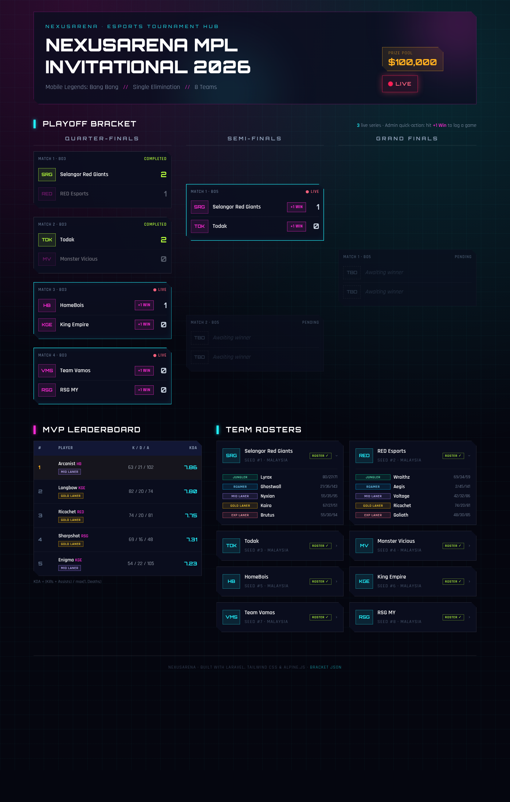
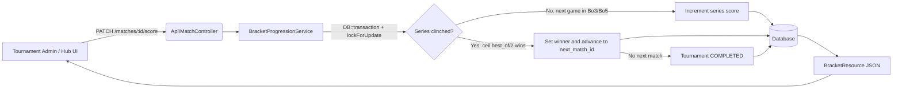
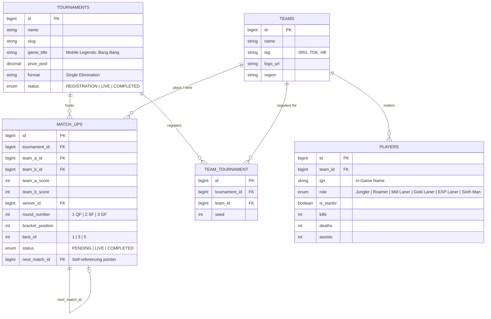

<div align="center">
  <h1>🏆 NexusArena: Esports Tournament & Team Hub</h1>
  <p><strong>A Laravel tournament bracket engine, team roster manager, and live match dashboard for Mobile Legends: Bang Bang.</strong></p>

  <p>
    
    
    
    
    
    
  </p>

  <p>
    <a href="#%EF%B8%8F-system-architecture">Architecture</a> •
    <a href="#%EF%B8%8F-database-schema-er-diagram">Database ER Diagram</a> •
    <a href="#-api-endpoints">API Reference</a> •
    <a href="#-quick-start-with-pre-seeded-bracket-data">Quick Start</a>
  </p>

  
</div>

---

## ⚡ Key Engineering Features

* **Automated Bracket Progression:** `BracketProgressionService::recordGameWin()` runs inside `DB::transaction()`, locks the match and the next bracket node with `lockForUpdate()`, and advances the series winner (`Quarter-Finals` → `Semi-Finals` → `Grand Finals`). Odd bracket positions feed `team_a`, even positions feed `team_b`; a node goes `LIVE` once both teams are in, and winning the Grand Final completes the tournament.
* **Best-of Series Logic:** A series is clinched at `ceil(best_of / 2)` wins, so Bo1, Bo3 and Bo5 all work the same way.
* **Role-Locked Roster Validation:** `RosterValidationService` requires at least 5 active starters covering Jungler, Roamer, Mid Laner, Gold Laner and EXP Laner before a team can register. A Sixth Man on the bench is allowed but does not count.
* **KDA & MVP Leaderboard:** Players are ranked by `(Kills + Assists) / max(1, Deaths)`, computed in SQL so it works on PostgreSQL, MySQL and SQLite.
* **Interactive Dashboard:** A Blade, Tailwind CSS and Alpine.js hub with a 3-column bracket. Each team in a `LIVE` match has a `+1 Win` admin button that calls the API and redraws the bracket without a page reload.
* **Service-Oriented Architecture:** Controllers → Services → Eloquent models, with API Resources shaping the JSON.
* **Headless API Ready:** A Postman collection is included at [`docs/postman_collection.json`](docs/postman_collection.json).

---

## 🏗️ System Architecture



### Project Structure

```
app/
├── Exceptions/BracketException.php            # 422 JSON for invalid results
├── Http/Controllers/
│   ├── TournamentDashboardController.php      # Web hub
│   └── Api/
│       ├── MatchController.php                # Bracket + score endpoints
│       ├── TeamController.php                 # Roster endpoint
│       ├── TournamentRegistrationController.php
│       └── LeaderboardController.php          # MVP endpoint
├── Http/Resources/{BracketResource,MatchUpResource}.php
├── Models/{Tournament,Team,Player,MatchUp}.php
└── Services/
    ├── BracketProgressionService.php
    └── RosterValidationService.php
database/seeders/TournamentSeeder.php          # 8-team MPL-style bracket
resources/views/tournament/hub.blade.php       # Dark esports dashboard
```

> The match model is named `MatchUp` because `match` is a reserved keyword in PHP 8+.

---

## 🗄️ Database Schema (ER Diagram)



---

## 🔌 API Endpoints

All endpoints are prefixed with `/api/v1` and return JSON.

| Method | Endpoint | Description | Auth |
| :--- | :--- | :--- | :--- |
| `GET` | `/api/v1/tournaments/{id}/bracket` | Full bracket grouped by round, ready for rendering | Public |
| `GET` | `/api/v1/teams/{tag}/roster` | Players, roles, KDA stats, and roster validity for a team | Public |
| `POST` | `/api/v1/tournaments/{id}/register` | Registers `team_id` after checking 5-role starter requirements | Open (demo) |
| `PATCH` | `/api/v1/matches/{id}/score` | Logs a game win for `winning_team_id` and auto-advances the bracket when the series ends | Open (demo) |
| `GET` | `/api/v1/leaderboards/mvp` | Players ranked by KDA (`?tournament_id=` and `?limit=` are optional) | Public |

> **Note:** Write endpoints are left open so the demo dashboard works out of the box. Put them behind authentication (e.g. Laravel Sanctum plus an admin/referee policy) before using this in production.

**Example: record a game win**

```bash
curl -X PATCH http://localhost:8000/api/v1/matches/6/score \
  -H "Accept: application/json" -H "Content-Type: application/json" \
  -d '{"winning_team_id": 3}'
```

The response includes the updated `match` and the full `bracket`. Invalid results (match not `LIVE`, or a team that is not in the match) return `422` with a `message`.

---

## 🚀 Quick Start (With Pre-Seeded Bracket Data)

**Requirements:** PHP 8.3+, Composer, Node.js 20+. SQLite is the default, so no database server is needed.

```bash
# 1. Clone the repository
git clone https://github.com/Wishprogram01/E-sport-Tournament-Hub.git
cd E-sport-Tournament-Hub

# 2. Install dependencies & configure environment
composer install && npm install
cp .env.example .env
php artisan key:generate
touch database/database.sqlite

# 3. Run migrations with the Esports Tournament Seeder
php artisan migrate --seed

# 4. Build frontend assets and start the local server
npm run build
php artisan serve
```

Open http://localhost:8000. To reset the bracket after playing through it, run `php artisan migrate:fresh --seed`.

### Using PostgreSQL or MySQL

Update `.env` and run the migrations again:

```dotenv
DB_CONNECTION=pgsql        # or mysql
DB_HOST=127.0.0.1
DB_PORT=5432               # 3306 for MySQL
DB_DATABASE=nexusarena
DB_USERNAME=postgres
DB_PASSWORD=secret
```

### What the seeder creates

* **1 live tournament:** *NexusArena MPL Invitational 2026*, with a $100,000 prize pool.
* **8 teams:** Selangor Red Giants (SRG), Todak (TDK), HomeBois (HB), Team Vamos (VMS), RSG MY (RSG), King Empire (KGE), Monster Vicious (MV) and RED Esports (RED).
* **40 starters:** 5 per team, one for each core role, with pre-filled K/D/A stats. Player IGNs are fictional.
* **Full 8-team bracket:** Quarter-Finals 1 and 2 are already complete, so Semi-Final 1 (SRG vs TDK) is `LIVE`. Quarter-Finals 3 and 4 are also `LIVE` and waiting for results.

---

## 🧪 Testing

```bash
php artisan test
```

The feature tests cover bracket progression (odd/even slot placement, series clinch, Grand Final completion, invalid results), roster validation and registration, and every API endpoint.

---

## 📄 License

Released under the [MIT License](LICENSE).
