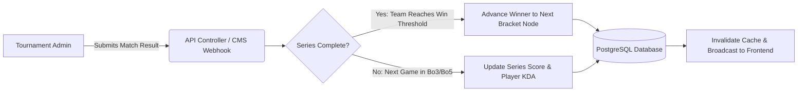
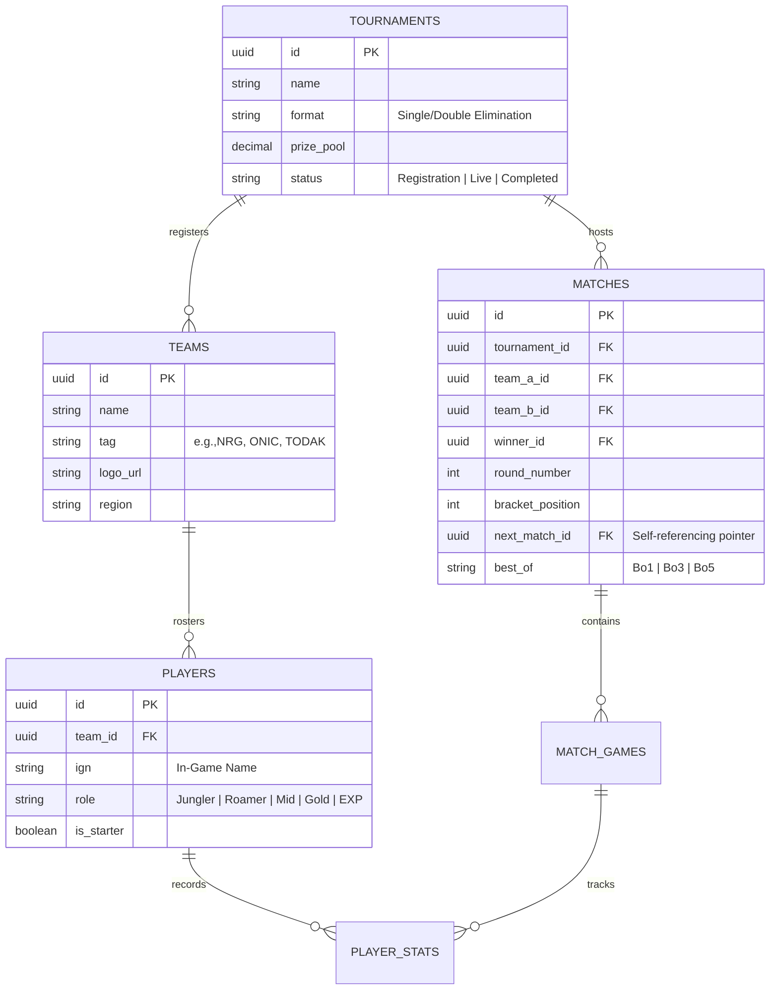

<div align="center">
  <h1>🏆 NexusArena: Esports Tournament & Team Hub | ON DEVELOPMENT</h1>
  <p><strong>A decoupled tournament bracket engine, team roster manager, and live match statistics platform.</strong></p>

  <!-- Dynamic Shields.io Badges -->
  <p>
    
    
    
    
    
  </p>

  <p>
    <a href="#-system-architecture">Architecture</a> •
    <a href="#-database-schema">Database ER Diagram</a> •
    <a href="#-api-endpoints">API Reference</a> •
    <a href="#-quick-start">Quick Start</a>
  </p>
</div>

---

## ⚡ Key Engineering Features

* **Automated Bracket Progression:** Entering a final match score triggers an event listener/webhook that automatically advances the winning team to the next bracket node (`Quarter-Finals` -> `Semi-Finals` -> `Grand Finals`).
* **Role-Locked Roster Validation:** Enforces composition constraints (e.g., 5 active starters + 1 sixth-man substitute, verifying roles such as Jungler, Roamer, Gold Lane, EXP Lane, and Mid Lane before locking tournament registration).
* **KDA & MVP Aggregation Engine:** Computes real-time Player Kill/Death/Assist ratios, Gold Per Minute (GPM), and team win-rates across Best-of-3 (Bo3) and Best-of-5 (Bo5) series.
* **Headless API Ready:** Includes a full Postman collection (`docs/postman_collection.json`) for testing decoupled endpoints.

---

## 🏗️ System Architecture

GitHub natively renders this workflow showing how match updates propagate from the admin panel to the live bracket UI:



---

## 🗄️ Database Schema (ER Diagram)



---

## 🔌 API Endpoints

| Method | Endpoint | Description | Auth Required |
| :--- | :--- | :--- | :--- |
| `GET` | `/api/v1/tournaments/{id}/bracket` | Returns full nested JSON bracket tree for rendering | Public |
| `GET` | `/api/v1/teams/{tag}/roster` | Fetches active players, roles, and career KDA stats | Public |
| `POST` | `/api/v1/tournaments/{id}/register` | Registers a team and validates 5-man role constraints | Team Captain |
| `PATCH` | `/api/v1/matches/{id}/score` | Logs game winner and auto-advances bracket if series ends | Admin / Referee |
| `GET` | `/api/v1/leaderboards/mvp` | Ranks tournament players by KDA, GPM, and kill participation | Public |

---

## 🚀 Quick Start (With Pre-Seeded Bracket Data)

Clone the project and spin up a complete 8-team tournament bracket in under 2 minutes:

```bash
# 1. Clone the repository
git clone [https://github.com/yourusername/nexus-esports-hub.git](https://github.com/yourusername/nexus-esports-hub.git)
cd nexus-esports-hub

# 2. Install dependencies & configure environment
composer install && npm install
cp .env.example .env
php artisan key:generate

# 3. Run migrations with the Esports Tournament Seeder
php artisan migrate --seed

# 4. Start the local server
php artisan serve
```

### 🔐 Demo Credentials (Auto-Generated by Seeder)
| Role | Email | Password |
| :--- | :--- | :--- |
| **Tournament Marshal (Admin)** | `marshal@nexusarena.gg` | `password123` |
| **Team Captain Demo** | `captain@todak.gg` | `password123` |
